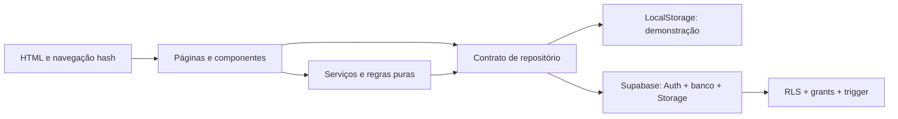

# Arquitetura — FiscalizaLixo IA

## Decisões e camadas

O fluxo e o estilo seguem os protótipos locais `02-Arquitetura-Robusta` e a memória pedagógica. O pedido atual exige Vite vanilla e JavaScript sem TypeScript, prevalecendo sobre a antiga sugestão React/TypeScript da memória. O aplicativo não depende dos arquivos externos de referência.

`main.js` inicia a composição em `app.js`. Páginas apresentam os dados; componentes concentram UI repetida. Serviços cuidam de classificação, imagem e envio. Utilitários puros validam campos, transições e calculam filtros/agregações. Leaflet mostra coordenadas aproximadas; Chart.js representa contagens calculadas. As bibliotecas são incorporadas ao build pelo npm, sem CDN necessária ao código.

## Persistência

O catálogo de coleta usa `CollectionPointRepository`, com a mesma sessão Supabase do módulo de ocorrências e uma tabela independente, `fiscaliza_collection_points`. A leitura pagina com contagem exata. A projeção pública não inclui `created_by`. RLS permite ler unidades publicadas e somente as sugestões pendentes do próprio autor; INSERT é limitado a campos de proposta. O cliente não tem UPDATE, DELETE ou permissão para publicar. Correções usam `replaces_id` e não podem ser publicadas como unidades independentes. As migrações `004` e `005` instalam o módulo e os cinco ecopontos de Itumbiara, preservando ajustes posteriores do catálogo. A demonstração usa uma cópia de referência e sugestões locais, sem mascarar falhas de um backend configurado. Veja [o processo de validação e atualização de coordenadas](collection-points.md).

`OccurrenceRepository` define operações assíncronas. A fábrica escolhe `LocalOccurrenceRepository` sem variáveis ou `SupabaseOccurrenceRepository` com configuração. O modo local identifica exemplos fictícios e persiste registros/fotos somente no dispositivo. Uma falha do backend configurado é mostrada, sem troca silenciosa para armazenamento local.

No modo Supabase, `init()` restaura/cria a sessão anônima. `list()` combina as linhas próprias completas com a projeção comunitária, eliminando duplicatas por ID. `get()` conserva a distinção de acesso. `create()` exige revisão, envia a foto privada e grava a linha; uma falha não produz sucesso. `updateStatus()` envia somente o novo status e o banco gera o histórico.

`list()` percorre páginas com contagem exata, ordenadas por `created_at` e `id`, avançando pelo número de linhas recebido mesmo quando o limite do servidor é menor que o tamanho solicitado. Uma contagem alterada, página inesperadamente vazia ou ID repetido interrompe a leitura com uma mensagem para tentar novamente. `get(id)` consulta diretamente o registro próprio e, se necessário, a projeção comunitária, sem carregar a lista inteira. Veja [os modificadores de faixa do Supabase](https://supabase.com/docs/reference/javascript/range).

O serviço de envio associa uma chave à tentativa lógica. A revisão persiste `submission_request_id` no rascunho; esse campo não é enviado como coluna nem guardado nos registros locais. O caminho da foto usa essa chave e a migração `002` torna `image_path` único nas linhas não nulas. Antes de enviar e depois de uma resposta incerta, o adaptador procura uma linha própria com esse caminho. Recuperar uma linha comprova o sucesso; uma falha de rede, isoladamente, não autoriza remover a foto. Somente uma rejeição definitiva, sem linha recuperada, permite compensar o upload.

O repositório local valida a estrutura de cada registro, as datas, coordenadas, classificação, faixa de risco e histórico antes do consumo pelas páginas. Falhas preservam o conteúdo original; apenas a ausência da chave inicializa exemplos. O README explica como copiar o JSON para recuperação manual.

## Privacidade e autoridade

`fiscaliza_occurrences` tem RLS e grants por coluna. A função `get_fiscaliza_community_occurrences()` usa `SECURITY DEFINER`, `search_path` vazio, exige `auth.uid()` e retorna uma lista fixa de campos. Não retorna autor, relato livre, foto ou histórico. Alterar essa lista exige revisão de privacidade.

O bucket `fiscaliza-photos` é privado, aceita JPEG/PNG/WebP até 5 MiB e exige UUID do usuário na primeira pasta. Somente o autor envia e lê suas fotos. A migração `003` permite remover uploads órfãos, mas bloqueia a exclusão de fotos referenciadas por ocorrências próprias. Não existe policy de sobrescrita; a leitura usa URL assinada temporária. As tabelas de ocorrências não possuem campos de nome, telefone, e-mail ou documento do cidadão.

As migrações devem ser aplicadas na ordem `001 → 002 → 003`. A `003` acrescenta à policy INSERT uma consulta `EXISTS` em `storage.objects`, limitada ao bucket correto e ao caminho da foto. Ela concede explicitamente SELECT de `bucket_id` e `name` a `authenticated`, sem remover grants gerenciados anteriores do Storage; as policies de leitura continuam filtrando linhas. A policy DELETE consulta as ocorrências próprias antes de permitir compensar um upload órfão. Essas subconsultas usam as policies SELECT, sem recursão entre INSERT e DELETE.

A checagem verifica metadados, não pixels, conteúdo semântico ou presença física durável do arquivo. Sem locks ou uma transação distribuída com o Storage, INSERT e DELETE concorrentes ainda podem criar uma referência sem arquivo. A migração não audita nem repara registros anteriores; uma garantia transacional mais forte exige outra estratégia. A limpeza de arquivos reais deve usar a API do Storage, não DELETE manual em `storage.objects`.

RLS e grants são a autoridade de acesso, independentemente dos botões visíveis. O trigger preserva identidade/autoria, valida transições, registra datas e histórico e recalcula classificação, risco e orientação. Os pontos no navegador explicam o resultado antes do envio; a regra SQL impede valores inventados por um cliente modificado. Ao evoluir pesos, altere testes e crie outra migração para instalações existentes.

Não há administrador no cliente. Um perfil institucional real exige identidade verificável, papéis, policies e auditoria próprios. Uma mudança de status pelo cidadão não significa encaminhamento oficial.

## Navegação e acessibilidade

Rotas hash permitem recarregar telas em hospedagem estática. Labels associados, foco visível, landmarks, estados claros e texto além da cor apoiam uso por teclado e toque. A versão móvel reorganiza o mesmo conteúdo e respeita redução de movimento. Filtros e indicadores derivam da lista do repositório, mantendo a origem dos números rastreável.

## Limites

Em 03/11/2026, as duas migrações iniciais e os dois seeds foram executados juntos em PostgreSQL local com PGlite. Passaram 48 verificações no total: instalação sem colisão de prefixos, seed idempotente, RLS por autoria, projeção comunitária sem campos privados, grants, transições e histórico, recálculo de risco e orientação, coordenadas aproximadas e policies de fotos. Em 04/11/2026, outras 12 verificações validaram as migrações `002` dos dois apps: índice único, caminhos nulos dos exemplos, reaplicação e preservação de dados/autoria. Esses testes usaram Auth/Storage simulados. Ainda em 04/11, 49 checks locais validaram a `003`, com preservação de linhas e policies sem recursão. Separadamente, o backend hospedado passou nos 26 checks reais anteriores à `003`, com quatro sessões, registros e fotos sintéticos. A `003` foi aplicada no projeto hospedado em 04/11 com Success. Em 05/11, o pós-check confirmou as quatro policies de proteção de foto e uma rodada instrumentada passou em 28 checks reais, 14 por app, incluindo recusa de INSERT sem foto/bucket incorreto, proteção de foto referenciada e compensação de órfãos pela API. Dois novos registros e fotos sintéticos foram preservados, somando seis registros de teste, três por app. Uma tentativa parcial anterior não foi considerada aprovada; seu possível upload órfão continua separado da limpeza verificada na rodada instrumentada. Os seeds nunca foram executados no Supabase hospedado. Veja [o relatório de verificação](verification.md).

LocalStorage não oferece sincronização, backup ou proteção de servidor. A sessão anônima não recupera autoria após ser perdida. `classificationService` é o ponto de extensão para uma API futura com credenciais no servidor e revisão humana. O projeto mantém “IA” no nome, mas a versão atual usa regras transparentes e não interpreta a foto. Uma API real de visão computacional é uma evolução futura.

Os testes automatizados locais usam repositório local e mocks do adaptador; a evidência hospedada é registrada separadamente e não é substituída por eles. Embora a listagem já percorra todas as páginas, o crescimento do piloto exige filtros e agregação no servidor, moderação, proteção contra abuso/CAPTCHA e retenção. CSP e cabeçalhos adicionais ainda não foram configurados pelo app; são defesa opcional a avaliar conforme a hospedagem, antes da publicação.
